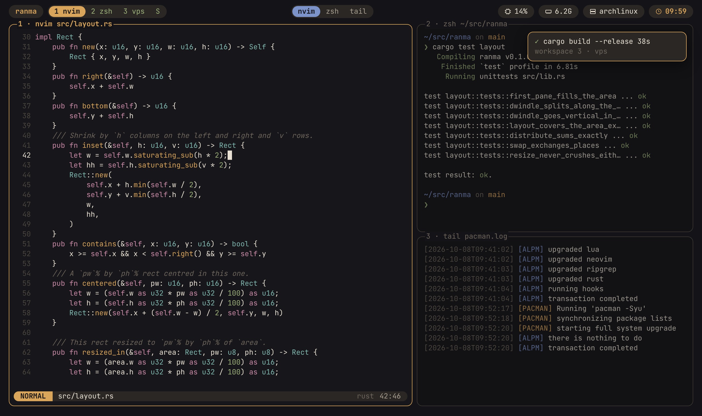

# ranma



A tiling window manager for the terminal: i3's container tree and Hyprland's
dwindle placement, where every window is a PTY. Sessions, workspaces, a floating
layer and a scratchpad, driven by a leader key and a modal WM mode, configured in
Lua and themed in TOML.

Named for the 欄間, the carved transom panel above sliding doors.


**Status:** a daily driver. Every milestone of
[`doc/ROADMAP.md`](doc/ROADMAP.md), 0-13, is done (one plugin primitive aside):

- dwindle-tiled panes, tabbed groups, a floating layer, a scratchpad, and a
  scrolling layout (niri's strip of columns); workspaces and sessions with
  fuzzy switchers; window rules and saved layouts
- copy mode and history search with the system clipboard (OSC 52, over SSH
  too); images in panes (the kitty graphics protocol) and the kitty keyboard
  protocol
- a waybar-style bar with Lua and shell modules, which nested ranmas share
  rather than stack; a mobile view while a phone drives the screen; pasting
  files into a pane that runs ssh
- it runs as a server: closing the terminal (or losing SSH) only detaches, and
  `ranma` again picks up where you were; an upgrade moves running servers to
  the new build without closing anything
- Lua plugins in Neovim's layout, with screens built from ready-made blocks; a
  plugin that fails while loading is dropped whole, and a watchdog stops one
  that hangs

## First steps

**The leader is `Ctrl+b`**, the same key tmux uses. Press it and let go, and
ranma enters **WM mode** (` WM ` in the bar): the keys you press now go to
ranma instead of the program in the pane. Wait half a second and a panel lists
what each key does. `Esc` or `Enter` leaves WM mode. Throughout the docs,
`leader t` means "press `Ctrl+b`, let go, then press `t`".

| Keys | Does |
| --- | --- |
| `leader t` | open a pane next to the focused one |
| `leader ←↓↑→` | move focus (`Alt+←↓↑→` does it without the leader) |
| `leader q` | close the focused pane |
| `leader 1`…`0` | go to workspace 1-10 (`Alt+1`…`Alt+0` without the leader) |
| `leader w` | float the pane, or put it back in the tiling |
| `leader d` | detach: ranma keeps running, and `ranma` brings you back |
| `leader ?` | every key, searchable |
| `leader :` | run any action by name |
| `leader p` | the settings panel |

The leader is a setting: `ranma.set { leader = "ctrl+a" }` in
`~/.config/ranma/init.lua`. `ranma --dump-config` prints the default
configuration, which lists every key and option with what it does, and `man
ranma-keys` lists the keys. In WM mode, pressing the leader again sends it to
the program in the pane.

**The bar is on by default, at the bottom, in plain colours.** The one in the
screenshot above is a theme and a few modules:
[`doc/examples/screenshot/`](doc/examples/screenshot) is that configuration,
ready to copy (it needs a Nerd Font). Its
[README](doc/examples/README.md) says how to try it without touching your own
config (not from inside a running ranma: a nested one hands its bar to the
outer one), and what in the screenshot it cannot reproduce. [`doc/CONFIG.md`](doc/CONFIG.md), "The bar" and "Themes", covers
the rest.

## Plugins

Plugins are plain Lua using the same API as `init.lua`
([`doc/CONFIG.md`](doc/CONFIG.md), "Plugins"; `ranma --dump-types` prints it
for your editor). [hako](https://github.com/masshirodev/hako.ranma) installs
and keeps them, shaped like lazy.nvim (without the lazy-loading): specs in
Lua, a lockfile, and a screen to update, install and clean. It comes with
ranma: the first start clones it, and a spec file in
`~/.config/ranma/lua/plugins/` is all a plugin takes (`plugin_manager =
"none"` opts out). **Browse** (`leader L`, then `B`) shows every plugin of the
[official list](https://github.com/masshirodev/ranma-plugins), and of any list
you add, installed with one key. A few to start from:

- [history.ranma](https://github.com/masshirodev/history.ranma): search a
  pane's scrollback by regex and jump to a match
- [compose.ranma](https://github.com/masshirodev/compose.ranma): write a prompt
  in `$EDITOR` and have it pasted where you were (an AI CLI's prompt box, say)
- [openpath.ranma](https://github.com/masshirodev/openpath.ranma): Ctrl+click a
  path in a pane to open it, or copy its content
- [linkhover.ranma](https://github.com/masshirodev/linkhover.ranma): where a link
  goes, on hover
- [agents.ranma](https://github.com/masshirodev/agents.ranma): what each AI
  agent running in a pane is doing (needs
  [ai-session](https://github.com/masshirodev/ai-session))

## Install

Release builds run on any Linux with glibc 2.34 or newer (Ubuntu 22.04,
Debian 12, Fedora 35, RHEL 9 and later), on x86_64 and aarch64.

Any distro, into `~/.local` (or `/usr/local` as root); run it again to update:

```sh
curl -fsSL https://masshirodev.github.io/ranma/install.sh | sh
```

Debian and Ubuntu, from the apt repository:

```sh
sudo install -d /etc/apt/keyrings
curl -fsSL https://masshirodev.github.io/ranma/ranma.asc | sudo tee /etc/apt/keyrings/ranma.asc >/dev/null
echo "deb [signed-by=/etc/apt/keyrings/ranma.asc] https://masshirodev.github.io/ranma/deb stable main" \
  | sudo tee /etc/apt/sources.list.d/ranma.list
sudo apt update && sudo apt install ranma
```

Fedora, RHEL and openSUSE, from the dnf repository:

```sh
sudo curl -fsSL -o /etc/yum.repos.d/ranma.repo https://masshirodev.github.io/ranma/ranma.repo
sudo dnf install ranma      # openSUSE: sudo zypper addrepo https://masshirodev.github.io/ranma/ranma.repo && sudo zypper install ranma
```

Homebrew (Linux, and macOS from 0.3.0): `brew install masshirodev/tap/ranma`.

Arch, from the AUR: `ranma-bin` (the release binary).

Nix: `nix run github:masshirodev/ranma`, or `packages.<system>.default` /
`overlays.default` of the flake in a NixOS or home-manager config.

Rust users: `cargo binstall ranma` (the release binary) or `cargo install
ranma` (built). npm: `npm install -g @masshirodev/ranma` (Node stays running
beside each client; the others do not need it).

Or by hand: each [release](https://github.com/masshirodev/ranma/releases) has
the tarball, `.deb` and `.rpm` for both architectures. Put `ranma` on your
`PATH` and the `man/` pages under a `share/man` beside it.

A package manager replaces the binary but skips what `install.sh` does after
an upgrade. Run it yourself:

```sh
ranma --check-config && ranma upgrade --all   # check the new build, then move running servers onto it
```

From source:

```sh
./install.sh            # build, install to ~/.cargo/bin, check it against your config
./install.sh --check    # run the full pre-commit gate first
./install.sh --uninstall
```

**Linux and macOS** (macOS from 0.3.0, arm64 and Intel). WSL2 works. The BSDs
and native Windows do not: what ranma asks the OS about a pane (its program,
its directory) is answered by `/proc` on Linux and libproc on macOS, and
nothing else is written yet (doc/DESIGN.md, "Linux and macOS, not native
Windows").

Needs Rust 1.88 or newer (`cargo`) and a C compiler (ranma builds its Lua from
source). Optional, at run time:

- `wl-paste` (wl-clipboard) or `xclip` for `paste_image` on Wayland or X11;
  under WSL it uses `powershell.exe`, and on macOS `osascript`, which is
  always there. Any other command can be set with
  `paste.image_command`.
- OpenSSH (`ssh`) on both ends for pasting files into a pane that runs ssh.
- `xdg-open` for opening links from hint mode.
- `tmux`, only for the smoke test (`scripts/smoke.sh`).

After installing, the new binary is run against your config; if it rejects it,
the previous binary is put back, so a terminal that starts ranma never falls
back to a plain shell because of an upgrade. Running instances keep the old binary until
they exit.

Then start it with `ranma` (or from your shell startup: see
[`doc/CONFIG.md`](doc/CONFIG.md)), and see [First steps](#first-steps) for the keys.

```sh
ranma --dump-config    # the default init.lua, which documents every option
ranma --check-config   # validate ~/.config/ranma/init.lua and its theme
```

The install also puts man pages beside the binary, in `~/.cargo/share/man`
(man-db finds them there by itself; with mandoc, the install says what to
add to `MANPATH`):
`man ranma` (the commands), `man 5 ranma` (the configuration, which is
`doc/CONFIG.md`) and `man ranma-keys` (the default keys). They are generated
and committed in [`doc/man/`](doc/man).

- [`doc/DESIGN.md`](doc/DESIGN.md): what ranma is, what it refuses to be, and why
- [`doc/CONFIG.md`](doc/CONFIG.md): the configuration and theme reference
- [`doc/ROADMAP.md`](doc/ROADMAP.md): milestones
- [`doc/TESTING.md`](doc/TESTING.md): what to run, and what each check proves
- [`doc/RELEASING.md`](doc/RELEASING.md): cutting a release, and the AUR packages
- [`doc/examples/`](doc/examples): whole configurations to copy, the screenshot's among them
- [`scripts/demo/README.md`](scripts/demo/README.md): re-recording the gif above

## How it's built

ranma is written with AI coding agents, directed and reviewed by its author.
The direction is in the documents, not the prompts: [`doc/DESIGN.md`](doc/DESIGN.md)
records every decision and what it rules out, [`doc/ROADMAP.md`](doc/ROADMAP.md)
the milestones, and nothing reaches `main` without passing fmt, clippy, the tests
and a smoke test that drives the release build in a headless tmux.

Commits carry no AI trailers. That's a choice about authorship, not
concealment: whoever commits a change answers for it.

## Contributing

[`CONTRIBUTING.md`](CONTRIBUTING.md) says what belongs in the core and what
belongs in a plugin, and how to send a change. Read
[`doc/DESIGN.md`](doc/DESIGN.md) first: it records the decisions and the
non-goals, and a feature on the non-goals list needs the design changed before
it needs a pull request. [`AGENTS.md`](AGENTS.md) has the conventions.

Arm the git hooks once per clone:

```sh
scripts/hooks.sh
```

They run `cargo fmt --check` and `cargo clippy --all-targets -- -D warnings` on
commit, and `cargo test` plus the smoke test on push. `doc/TESTING.md` says what
each check covers.

## License

Licensed under either of [Apache License, Version 2.0](LICENSE-APACHE) or
[MIT license](LICENSE-MIT), at your option.

Unless you explicitly state otherwise, any contribution intentionally submitted
for inclusion in ranma by you, as defined in the Apache-2.0 license, shall be
dual licensed as above, without any additional terms or conditions.
